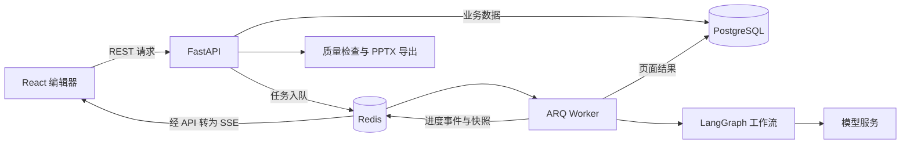

# SlideFlow

**面向内容创作与技术汇报的 AI 演示文稿生成平台。**

SlideFlow 将主题、长文本或文档转化为可确认的大纲，再通过后台任务并发生成页面。用户可以在线修改内容和排版，经过质量检查后导出原生可编辑的 PPTX 文件。

项目以 Python 后端和 React 前端为主要实践路线，关注结构化生成、异步任务编排、实时进度和文档导出。本版本完成了本地集成验证、SSE 可靠性修复与开发验证工具补充。

## 核心能力

- **多种材料输入**：支持主题、长文本和 PDF、Word、Markdown、TXT 文档解析，先生成大纲，由用户修改并确认。
- **异步并发生成**：ARQ Worker 执行生成任务，通过 asyncio 信号量控制单份 PPT 的页级并发，支持单页重试和软取消。
- **实时进度与在线编辑**：Redis 发布订阅与 SSE 推送进度；编辑器支持结构化内容修改、主题切换、灵活布局和 AI 修改预览。
- **质量检查与可编辑导出**：检查结构、文字容量、页面边界和内容质量，按 error 与 warning 分级，使用 python-pptx 构造原生对象并回读验证。

业务流程：**登录 → 创建项目 → 输入材料 → 生成并确认大纲 → 生成页面 → 在线编辑 → 质量检查 → 导出 PPTX**。

## 页面示例

本地试验中，将初稿的重复列表精简为三张卡片后的页面：


更多过程截图与质量检查结果见[运行验证记录](docs/VALIDATION.md)。

## 系统架构



API 接收请求后将耗时任务入队，Worker 在后台执行。整份 PPT 对应一个 ARQ 编排任务，页级并发发生在任务内部，默认同时生成 3 页。PostgreSQL 保存业务状态和内容，Redis 承担任务队列、进度通道和最近进度快照。

内容、布局、主题分别建模，前后端从 `shared/` 读取布局和主题定义。完整的模块说明与设计取舍见[架构说明](docs/ARCHITECTURE.md)。

## 技术栈

| 层次 | 技术 |
| --- | --- |
| 后端 API | Python、FastAPI、Pydantic、SQLAlchemy、Alembic |
| AI 工作流 | LangChain LCEL、LangGraph、兼容 OpenAI 协议的模型服务 |
| 异步与数据 | ARQ、asyncio、Redis、PostgreSQL JSONB |
| 内容解析与导出 | pdfplumber、python-docx、python-pptx、FontTools |
| 前端 | React、TypeScript、Vite、TanStack Query、Zustand、Tailwind CSS |
| 本地基础设施 | Docker Compose、PostgreSQL 16、Redis 7 |

仓库同时保留 `java_backend/`，它是另一套后端实现；以下运行步骤使用 Python 后端。

## 本地运行

需要 Python 3.12 或以上、uv、Node.js 和 Docker Desktop。本次验证使用 Python 3.13 与 Node.js 24。

以下命令在项目根目录的 PowerShell 中执行。安装前先停止已运行的 Vite，避免 Windows 下原生依赖文件被占用。

```powershell
docker compose up -d

cd backend
uv sync --locked
if (-not (Test-Path .env)) { Copy-Item .env.example .env }
```

编辑 `backend/.env`，填写模型密钥、服务地址和有效模型名。本次验证的配置为：

```dotenv
LLM_API_KEY=replace-with-your-key
LLM_BASE_URL=https://api.deepseek.com
LLM_MODEL=deepseek-flash
```

模型名以账号可用模型为准；不要仅依赖示例文件中的默认值。图片生成和图库密钥可以暂不配置，图片管线会降级到占位图。

```powershell
# 当前位于 backend
uv run alembic upgrade head

cd ../frontend
npm ci
npm run build
```

在三个独立终端中分别启动：

```powershell
# 终端一，backend 目录
uv run uvicorn app.main:app --reload --host 127.0.0.1 --port 39800
```

```powershell
# 终端二，backend 目录
uv run arq app.worker.settings.WorkerSettings
```

```powershell
# 终端三，frontend 目录
npm run dev
```

- 前端：[http://127.0.0.1:39173](http://127.0.0.1:39173)
- API 文档：[http://127.0.0.1:39800/docs](http://127.0.0.1:39800/docs)
- 健康检查：[http://127.0.0.1:39800/api/v1/health](http://127.0.0.1:39800/api/v1/health)

配置说明、测试隔离与常见问题见[本地运行指南](docs/LOCAL_DEVELOPMENT.md)。

## 本次实践与验证

| 项目 | 2026 年 10 月 15 日验证结果 |
| --- | --- |
| 本地业务链路 | 完成注册、创建项目、大纲生成、5 页页面生成、AI 内容修改及 PPTX 下载 |
| 真实模型任务耗时 | 大纲 15.92 秒，5 页生成任务 30.83 秒；均为单次任务执行耗时 |
| SSE 修复 | 先订阅再读取快照，补充终态收尾及连接清理，新增 3 个回归用例通过 |
| 后端测试 | 包含原有测试与新增用例的测试套件共 383 个用例通过 |
| 固定语料导出回归 | 2 种语料密度 × 4 个主题，共 8 个组合通过；208 个可度量槽位中溢出 0 个 |
| 前端构建 | TypeScript 检查与 Vite 生产构建通过 |

固定语料结果用于验证渲染与导出，真实模型生成仍可能出现文字溢出、内容重复与布局留白。详细条件、样本和待处理问题见[运行验证记录](docs/VALIDATION.md)。

## 项目文档

- [架构与核心代码导读](docs/ARCHITECTURE.md)
- [Windows 本地运行与排障](docs/LOCAL_DEVELOPMENT.md)
- [实测结果与质量问题记录](docs/VALIDATION.md)
- [项目经历与面试讲解](docs/PROJECT_EXPERIENCE.md)

## 来源与致谢

本项目基于[鱼皮与编程导航的 AI PPT 生成器项目](https://github.com/yuyuanweb/ai-ppt-generator)开展本地集成、运行验证与工程化改进。既有功能与本次迭代范围在[项目经历说明](docs/PROJECT_EXPERIENCE.md)中分别列出。
