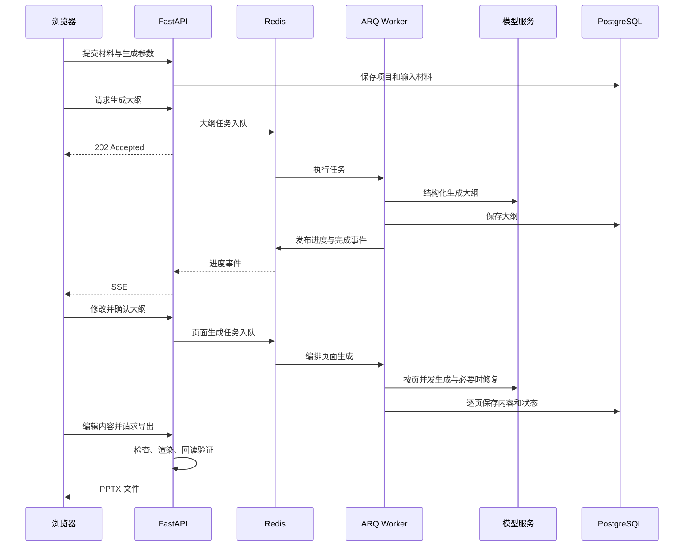

# SlideFlow 架构与核心代码导读

SlideFlow 围绕可编辑演示文稿组织生成链路：模型产出结构化内容，布局求解器决定元素位置，前端和 PPTX 渲染器分别消费这些数据。Python 主线由 FastAPI API、ARQ Worker、PostgreSQL、Redis 和 React 前端组成。

## 服务边界

| 组件 | 职责 | 核心入口 |
| --- | --- | --- |
| API | 鉴权、项目管理、输入解析、任务入队、编辑和导出 | [main.py](../backend/app/main.py) |
| Worker | 执行大纲任务、编排整份 PPT 的页面生成 | [settings.py](../backend/app/worker/settings.py) |
| 数据库 | 保存用户、项目、来源、大纲和页面 | [models](../backend/app/models/) |
| Redis | ARQ 队列、进度发布订阅、最近状态快照 | [events.py](../backend/app/services/events.py) |
| 前端 | 大纲确认、进度展示、页面编辑与导出交互 | [App.tsx](../frontend/src/App.tsx) |
| 共享资源 | 布局、主题与布局预设 | [shared](../shared/) |

API 和 Worker 分进程运行。浏览器提交生成请求后，API 保存状态并返回任务受理结果；Worker 随后调用模型。用户刷新页面时可以重新读取业务结果，并通过进度快照恢复展示。

## 生成与编辑流程



## 结构化模型调用与工作流

[StructuredChatClient](../backend/app/llm/client.py)通过 LCEL 组合提示词和聊天模型，使用 `with_structured_output(..., method="json_mode")` 与 Pydantic schema 约束返回结构。模型结果还需要通过字段、页数、布局和来源引用等业务校验。

大纲工作流负责准备输入并生成大纲。单页工作流则执行：

```text
准备来源片段 → 生成草稿 → 转换与布局适配 → 结构及内容检查
                                         ↓
                          必要时携带问题重新生成，最多修复一轮
```

结构错误、内容过瘦或空话等问题可以触发修复；溢出和容量 warning 不直接触发缩写重生成。这一取舍限制了模型调用次数，也意味着部分视觉问题仍需用户修改。

来源上下文按字符预算裁剪：大纲正文与标题总预算为 12,000 字符，单节正文最多 2,000 字符；单页正文总预算为 6,000 字符，单节正文最多 1,500 字符。单页接收大纲所引用的来源片段，当前主线没有向量检索或重排序环节。

相关代码：[outline.py](../backend/app/workflows/outline.py)、[slide.py](../backend/app/workflows/slide.py)、[deepseek.py](../backend/app/llm/deepseek.py)。

## 任务编排与失败处理

整份 PPT 的生成由一个 `generate_deck` ARQ 任务编排，内部通过 `asyncio.gather` 派发各页，并使用 `asyncio.Semaphore` 限制并发。默认 `SLIDE_CONCURRENCY=3`，作用范围是单个编排任务。

Worker 的 `max_jobs=3` 还允许同一进程同时执行多个队列任务，因此单份 PPT 的并发上限不能当成模型服务的全局限流。默认任务超时为 15 分钟。

页面按 `pending / generating / ready / failed` 保存状态。失败页面可单独重试；取消标记在每页开始前检查，已在生成的页面允许完成。`project_id + outline_page_id` 唯一约束避免同一大纲页重复建行。

相关代码：[deck_tasks.py](../backend/app/worker/deck_tasks.py)、[generation.py](../backend/app/api/v1/deck/generation.py)、[slide.py](../backend/app/models/slide.py)。

## SSE 快照与连接生命周期

发布进度时，Redis 事务同时更新最近快照和发布事件，快照有效期为一小时。客户端重新连接时可以立即获得最近状态，随后接收增量事件。

本次修复将读取顺序调整为：**订阅通道 → 读取快照 → 发送首帧 → 消费后续消息**。读取快照后产生的新事件可以留在订阅连接中，减少原先快照读取与订阅之间漏掉完成事件的窗口。首帧已经是终态时结束连接；退出时释放订阅资源。

快照和订阅之间可能出现重复状态，因此客户端应按完整状态更新界面；这套机制提供最近状态恢复，不提供历史事件逐条重放。

新增测试覆盖完成事件交接、终态快照直接收尾、心跳和连接清理。相关代码：[sse.py](../backend/app/api/sse.py)、[test_sse.py](../backend/tests/test_sse.py)、[useEventStream.ts](../frontend/src/hooks/useEventStream.ts)。

## 内容模型与在线编辑

页面使用结构化内容块表示文本、列表、卡片、图片、表格和图表。固定布局通过槽位放置内容，灵活布局通过布局树和求解器分配空间；主题单独管理配色、字体和文字样式。

编辑请求携带 `revision`，版本过期时返回 409。前端按页串行提交保存任务，并维护本地撤销与重做历史。这能识别过期提交；跨客户端同时编辑的原子性仍需要单独进行并发验证。

相关代码：[content.py](../backend/app/domain/content.py)、[flex_solve.py](../backend/app/domain/flex_solve.py)、[useSlideSaveQueue.ts](../frontend/src/features/deck/useSlideSaveQueue.ts)。

## 质量门禁与原生导出

导出过程执行四个步骤：

1. 检查所有页面是否已经就绪。
2. 检查结构、文字容量、边界、重复内容、数字来源覆盖等问题。
3. error 阻断导出，warning 提示核对；允许导出时构造 PPTX 原生对象。
4. 回读文件，验证页数、画布、原生对象和内容完整性后返回文件。

数字来源检查属于材料覆盖提示，不等价于事实核验。`thin_content` 规则按内容块数、要点和版面等启发式条件判断，其中块数统计使用 `len(slide.blocks)`；一个含三张卡片的 `cards` 块仍只计一个块。

Web 与 PPTX 共用内容、布局和主题定义，但分别由浏览器和 Office 渲染，仍需检查实际字体、换行和元素位置。

相关代码：[export.py](../backend/app/api/v1/deck/export.py)、[export_check.py](../backend/app/domain/export_check.py)、[quality.py](../backend/app/domain/quality.py)、[pptx.py](../backend/app/render/pptx.py)、[verify.py](../backend/app/render/verify.py)。

## 当前质量边界

本地试验暴露了长句堆积、占位图缺少信息价值、卡片被拉得过高，以及卡片组触发块数不足警告等问题。页面内容可以通过人工或 AI 修改改善，但布局自适应与质量规则的改进尚未落地。

这些问题、实测耗时和验证范围统一记录在[运行验证记录](VALIDATION.md)中。
