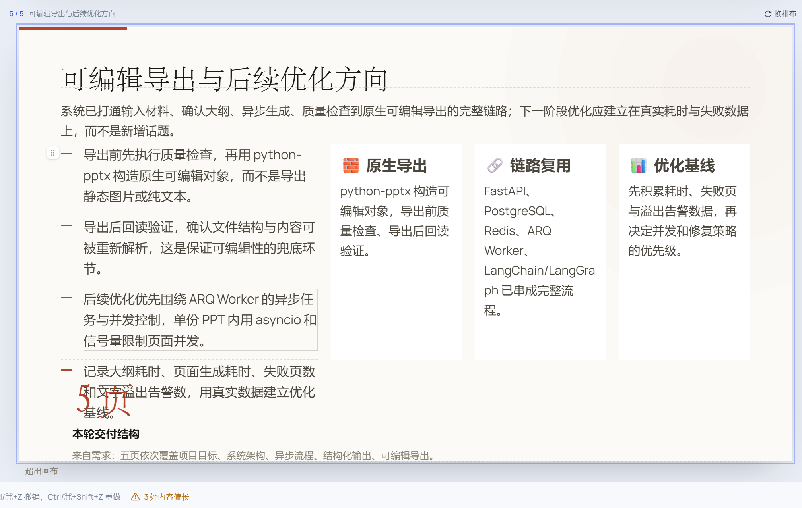
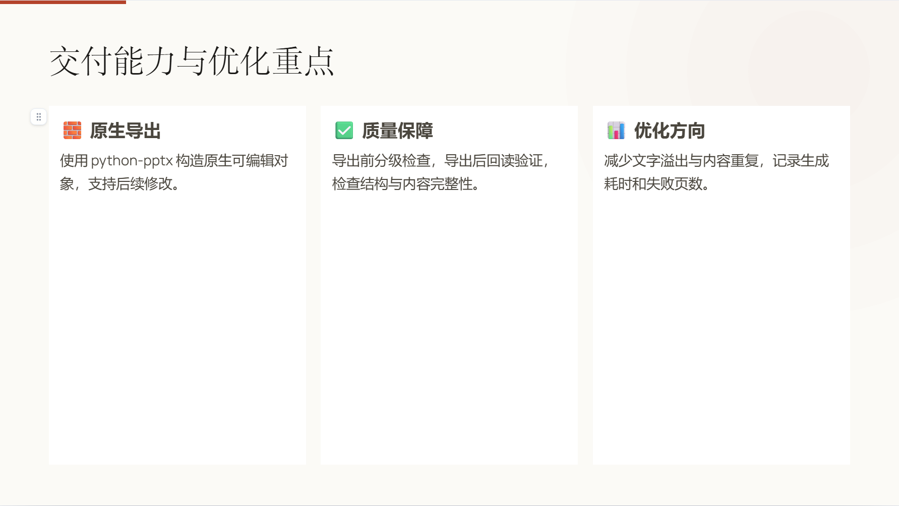

# SlideFlow 运行验证记录

验证日期为 2026 年 10 月 15 日，范围为 Windows 本地环境、Python 后端与 React 前端。结果分为人工业务试验、自动化测试和固定语料渲染回归。

## 真实模型业务试验

试验主题为 AI PPT 生成系统的架构与工程化设计，使用 5 页、中等内容密度和灵活排版。材料包含 React、FastAPI、PostgreSQL、Redis、ARQ、LangChain、LangGraph 与 python-pptx 的职责说明。

人工流程完成注册、项目创建、大纲生成、大纲确认、页面生成、单页再次生成、AI 内容修改和 PPTX 下载。图片服务未在这轮配置流程中补充，页面出现占位图。

| 阶段 | Worker 日志时间 | 执行耗时 |
| --- | --- | --- |
| 大纲任务 | 16:53:19 至 16:53:35 | 15.92 秒 |
| 首轮 5 页生成任务 | 17:04:06 至 17:04:37 | 30.83 秒 |
| 单页再次生成任务 | 17:04:55 至 17:05:08 | 13.51 秒 |

大纲任务另有 `delayed=317.43s`，反映 Worker 消费前的队列等待。任务执行耗时依据 ARQ 结束日志，不等同于纯模型推理耗时，也不包含此前排队延迟。

这些结果来自单次人工样本，不能据此计算平均延迟、P95、并发加速比或长期成功率。

## 页面修改与质量门禁

初稿第 5 页同时包含长列表、三张卡片、大号页数与底部说明，出现重复内容、文字重叠和超出画布。



通过 AI 修改，将内容精简为标题与三张卡片，删除重复列表、大号页数和底部说明。后续截图中的重叠现象已消失，但卡片仍然偏高、下方留白较多。



最终导出前报告允许继续导出，并提示两项 warning：

| 页码 | 质量提示 | 处理结果 |
| --- | --- | --- |
| 第 3 页 | 要点预计占用 166 pt，槽位高度 165 pt | 保留临界溢出预警，允许导出后进一步核对 |
| 第 5 页 | 当前 2 个内容块，中等密度建议至少 3 个 | 保留简洁内容，记录块数规则与卡片组语义的差异 |


第 5 页提示对应的规则按 `len(slide.blocks)` 统计块数，卡片组内部项目不会展开计数，因此视觉上的三张卡片不一定计为三个内容块。是否调整规则需要结合页面用途和样本验证，本轮未修改该规则。

用户已确认 PPTX 导出成功。PowerPoint 或 WPS 中逐元素编辑、字体匹配和跨端布局一致性尚未形成单独验收记录。

## 后端测试与 SSE 回归

在独立 `aippt_test` 数据库与 Redis 15 号库下执行后端测试，字体准备后结果为：

```text
383 passed in 25.24s
```

该数字包含项目原有用例和本次新增的 3 个 SSE 用例。

新增用例分别覆盖：

1. 首帧发送后、下一次读取前发布的完成事件能够送达。
2. 最近快照已经是终态时，连接立即结束。
3. 无快照时回退状态、心跳与连接清理。

修复前前两个用例失败，表现为漏掉完成消息或终态后继续等待；调整为先订阅后取快照，并补充终态与资源清理后，3 个用例全部通过。

## 固定语料导出回归

预置的 2 种语料密度与 4 个主题组合，共执行 8 组渲染与回读检查：

| 指标 | 结果 |
| --- | --- |
| 组合数 | 8 |
| 每组页数 | 11 |
| PPTX 回读可编辑性检查 | 8/8 通过 |
| 可度量文字槽位 | 208 |
| 文字溢出槽位 | 0/208 |
| 切换主题后内容一致性 | 通过 |
| 文字度量路径 | Noto 字体度量 |

本轮包含 ivory、midnight、obsidian、scholar 四个主题。语料来自仓库内固定 JSON，回归用于检查渲染和导出，不调用模型；它与前述真实生成样本属于不同验证范围。

## 前端构建与依赖检查

`npm ci` 安装完成，`npm run build` 的 TypeScript 检查与 Vite 构建通过。生成的主要 JavaScript 包约 902.16 kB，gzip 后约 267.22 kB，触发 500 kB 分包提示。

本次 `npm ci` 另报告 5 项 high 级别依赖告警，尚未根据 `npm audit` 明细定位和整改。先前 oxlint 检查还有 6 条警告。生产部署、负载测试与依赖安全整改不属于已完成验收项。

## 后续候选优化

| 观察 | 候选方向 | 当前状态 |
| --- | --- | --- |
| 短文本卡片仍被拉得过高 | 布局高度按内容与页面角色适配 | 待实现 |
| 卡片组触发块数不足提示 | 结合卡片内部条目与语义密度检查 | 待实现 |
| 输入要求出现在生成正文 | 分离素材事实与生成约束 | 待评估 |
| 部分页面只有装饰性占位图 | 按内容选择卡片、流程或配图 | 待评估 |
| 首屏包较大 | 路由及图表模块按需加载 | 待实现 |

上述问题目前作为运行结论保留，未计入已完成的代码优化成果。
